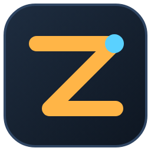
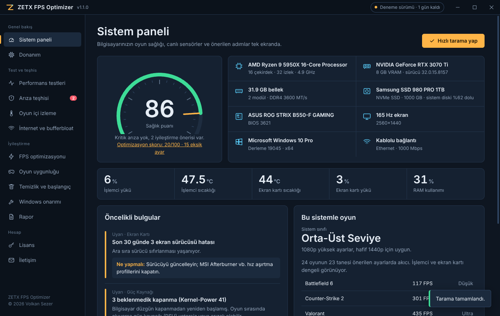
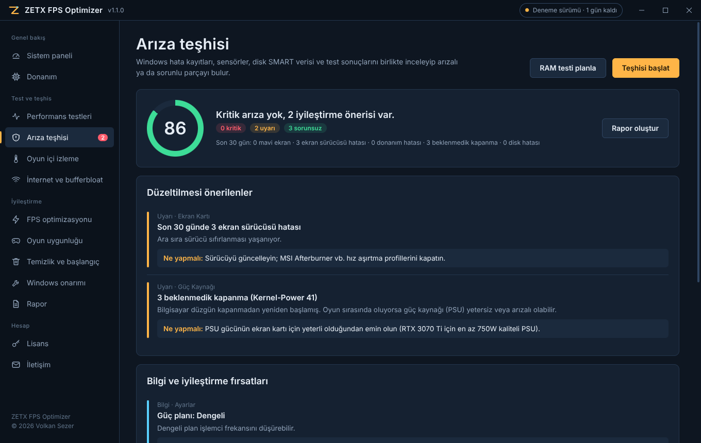
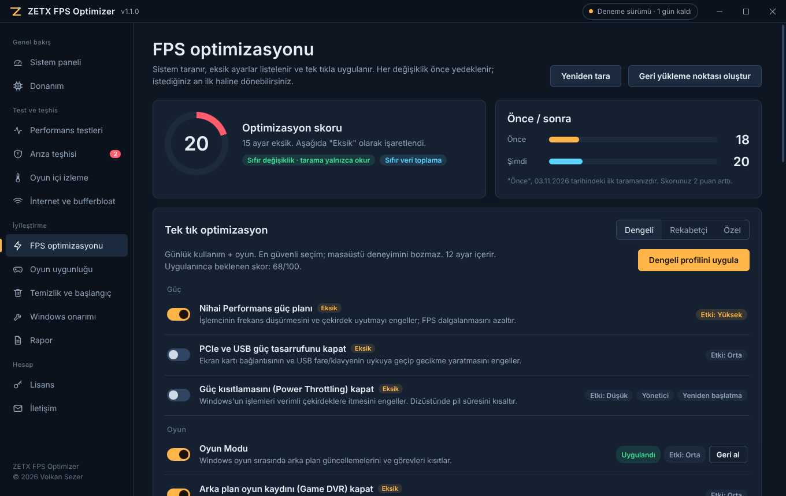
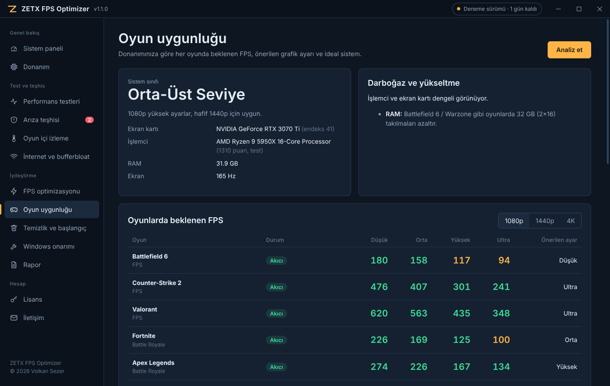
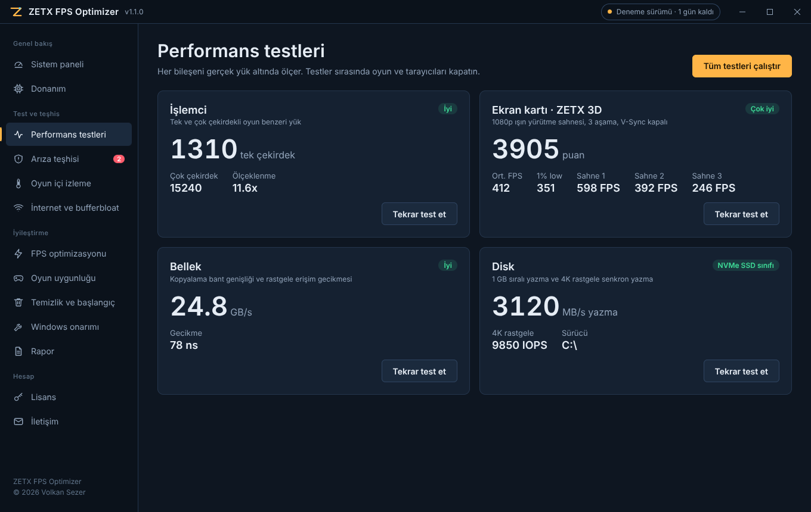
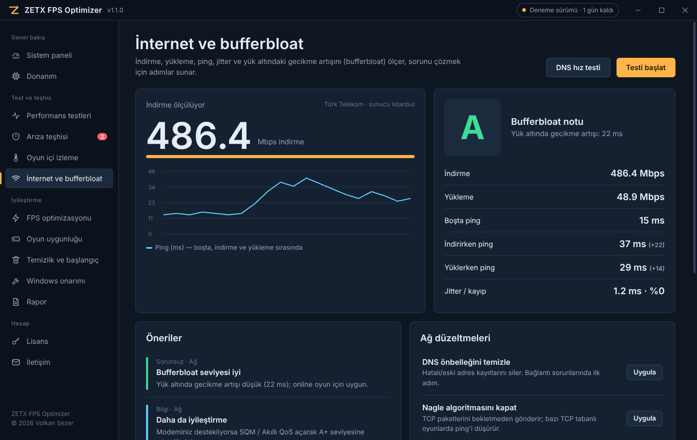
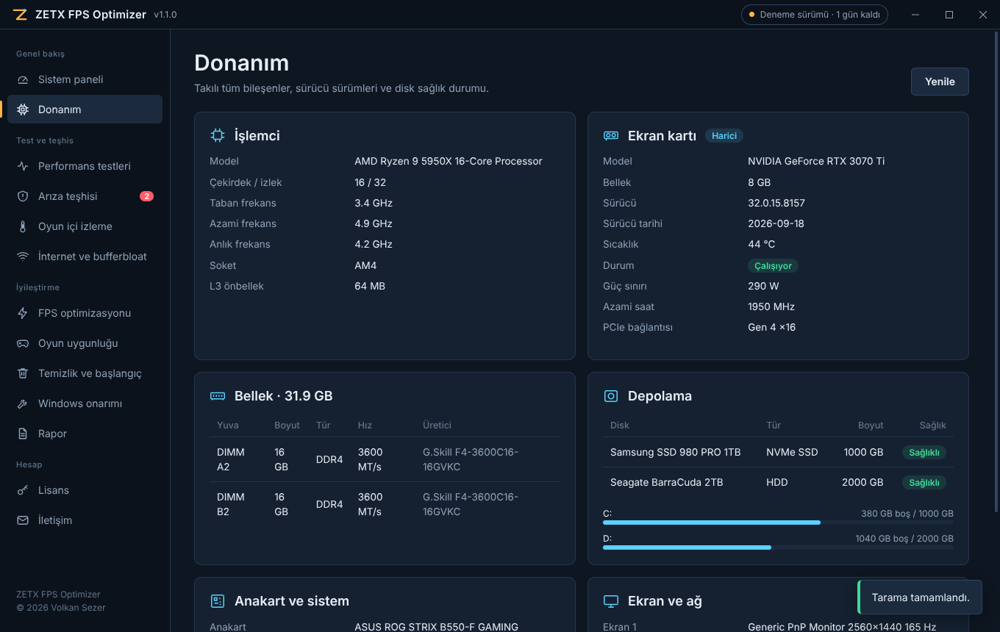
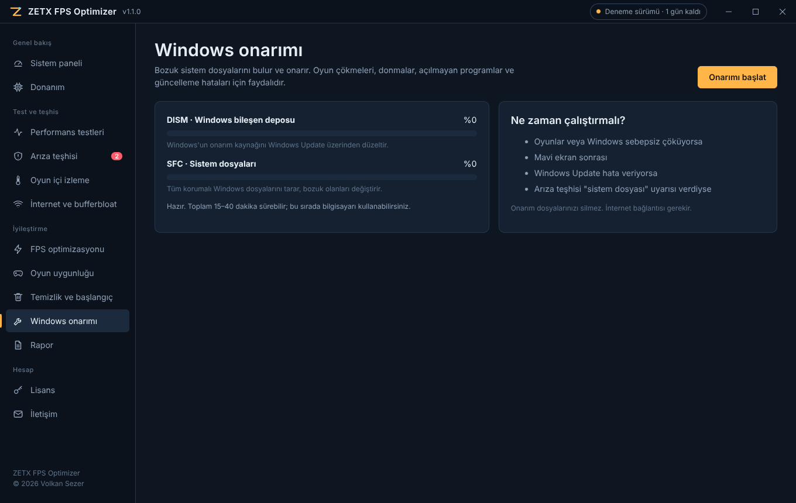
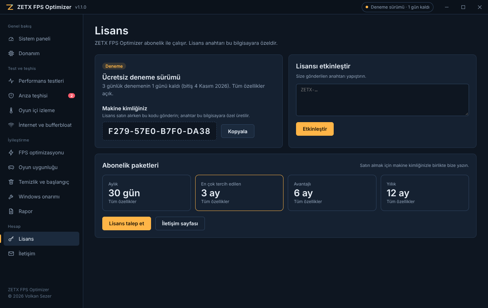

  

<h1 align="center">ZETX FPS Optimizer</h1>

  Bilgisayarınızın oyun performansını ölçen, arızalı donanımı bulan ve Windows'u tek tıkla oyun için ayarlayan program.

  
  
  
  

  <a href="https://github.com/wolkansezer/ZETX-FPS-Optimizer/releases/latest"><b>⬇ Son sürümü indir</b></a>

---

## Saatlerce ayar aramaya son

Oyun takılıyor, FPS düşüyor, ping zıplıyor. Çözüm için YouTube videolarında, forumlarda ve "FPS boost" dosyalarında saatler harcanıyor. Sonunda neyin değiştiği belli olmuyor, bozulan bir ayarı geri almak imkânsız hale geliyor.

ZETX FPS Optimizer bu işi tek programda toplar:

- Bilgisayarınızın her parçasını **test eder** ve puanlar.
- Windows hata kayıtlarını tarayıp **arızalı ya da sorunlu donanımı bulur**; neyin değişmesi gerektiğini söyler.
- Windows'u **tek tıkla oyun için ayarlar**. Her değişiklik önce yedeklenir, istediğiniz an geri alınır.
- Hangi oyunu **hangi ayarla, kaç FPS'le** oynayabileceğinizi gösterir.
- İnternetinizin oyun sırasındaki gerçek performansını (**bufferbloat**) ölçer ve çözüm sunar.

Program tamamen Türkçedir.

## İçindekiler

- [Özellikler](#özellikler)
- [Ekran görüntüleri](#ekran-görüntüleri)
- [Güvenlik ve gizlilik](#güvenlik-ve-gizlilik)
- [Kurulum](#kurulum)
- [Hızlı başlangıç](#hızlı-başlangıç)
- [Lisans ve abonelik](#lisans-ve-abonelik)
- [Sistem gereksinimleri](#sistem-gereksinimleri)
- [Sık sorulan sorular](#sık-sorulan-sorular)
- [İletişim](#iletişim)

## Özellikler

### Sistem paneli ve donanım analizi
- İşlemci, ekran kartı, RAM (modül modül), diskler, anakart, BIOS, monitör ve ağ bağdaştırıcısı tek ekranda.
- CPU ve ekran kartı sıcaklığı, yükü ve RAM kullanımı canlı olarak izlenir.
- **Hızlı tarama** ile sisteminiz 100 üzerinden bir **sağlık puanı** alır.

### Performans testleri
| Test | Ne ölçer |
| --- | --- |
| İşlemci | Oyun benzeri yükle tek çekirdek ve çok çekirdek puanı, çekirdek ölçeklenmesi |
| Ekran kartı (ZETX 3D) | 1080p, üç sahneli, V-Sync kapalı 3D test; ortalama FPS, 1% low ve puan |
| RAM | Bellek bant genişliği (GB/s) ve gecikme (ns) |
| Disk | 1 GB sıralı yazma hızı ve 4K rastgele yazma (IOPS) |

### Arıza teşhisi
Son 30 günün Windows kayıtlarını ve sensörleri birlikte inceler:
- Mavi ekranlar (BSOD), ekran sürücüsü çökmeleri (TDR), donanım hataları (WHEA)
- Beklenmedik kapanmalar (Kernel-Power 41), disk G/Ç hataları
- Disk SMART sağlığı, Windows Bellek Tanılama sonucu
- Kapalı XMP/EXPO profili, tek kanal RAM, eksik PCIe bağlantısı (ör. x16 yerine x4)
- Aşırı ısınma, eski ekran kartı sürücüsü, hatalı aygıtlar (ör. Kod 43)

Sonuçlar önceliğe göre sıralanır: **değiştirilmesi gerekenler, düzeltilmesi önerilenler, sağlıklı bileşenler**. Her bulgunun altında "Ne yapmalı" adımı yer alır. Örneğin sık sürücü çökmesi ve yüksek sıcaklık varsa ekran kartının arızalı olabileceğini söyler ve nasıl doğrulanacağını anlatır.

### Tek tık FPS optimizasyonu
- Sistem önce taranır ve 100 üzerinden bir **optimizasyon skoru** verilir. Tarama hiçbir ayarı değiştirmez.
- Eksik ayarlar "Eksik" olarak işaretlenir.
- Üç profil:
  - **Dengeli:** Günlük kullanım + oyun, 12 güvenli ayar.
  - **Rekabetçi:** CS2, Valorant, Battlefield 6 için en yüksek FPS ve en düşük gecikme, 19 ayar.
  - **Özel:** Ayarları tek tek siz seçersiniz.
- **Önce / sonra** karşılaştırması ile skorunuzun ne kadar arttığını görürsünüz.

<b>Optimizasyon ayarlarının tam listesi (19 ayar)</b>

| Kategori | Ayar | Dengeli | Rekabetçi |
| --- | --- | :---: | :---: |
| Güç | Nihai Performans güç planı | ✔ | ✔ |
| Güç | PCIe ve USB güç tasarrufunu kapat | | ✔ |
| Güç | Güç kısıtlamasını (Power Throttling) kapat | | ✔ |
| Oyun | Oyun Modu | ✔ | ✔ |
| Oyun | Arka plan oyun kaydını (Game DVR) kapat | ✔ | ✔ |
| Grafik | Donanım hızlandırmalı GPU zamanlaması (HAGS) | ✔ | ✔ |
| Grafik | Pencereli oyun optimizasyonu + VRR | ✔ | ✔ |
| Öncelik | Oyun görevlerine yüksek öncelik (MMCSS) | ✔ | ✔ |
| Öncelik | Öndeki pencereye (oyuna) işlemci önceliği | | ✔ |
| Ağ | Ağ kısıtlamasını kaldır | ✔ | ✔ |
| Windows | Teslim optimizasyonunu (eşler arası güncelleme) kapat | ✔ | ✔ |
| Windows | Windows Update oyun saatlerinde yeniden başlatmasın | ✔ | ✔ |
| Windows | Telemetri hizmetini (DiagTrack) kapat | | ✔ |
| Windows | Windows önerilerini ve reklamlarını kapat | ✔ | ✔ |
| Windows | Arka plan uygulamalarını kısıtla | | ✔ |
| Windows | Saydamlık ve animasyonları kapat | | ✔ |
| Windows | Açılış gecikmesini kaldır | ✔ | ✔ |
| Giriş | Fare ivmesini kapat (raw aim) | | ✔ |
| Giriş | Yapışkan tuşlar kısayolunu kapat | ✔ | ✔ |

**Gelişmiş: Bellek Bütünlüğü (VBS).** Bazı oyunlarda performans kaybına neden olan çekirdek yalıtımı açılıp kapatılabilir. Güvenlik ve anti-cheat uyarısıyla birlikte gelir.

Ekran kartı paneli (NVIDIA / AMD) ve oyun içi ayarlar için kartınıza özel öneriler de verilir.

### Oyun uygunluğu
- 24 popüler oyun için **1080p, 1440p ve 4K'da** Düşük / Orta / Yüksek / Ultra ayarlarda tahmini FPS.
- Battlefield 6, Counter-Strike 2, Valorant, Fortnite, Apex Legends, Call of Duty: Warzone, Rainbow Six Siege X, Overwatch 2, Marvel Rivals, PUBG, Delta Force, ARC Raiders, Escape from Tarkov, League of Legends, Dota 2, Cyberpunk 2077, GTA V Enhanced, Red Dead Redemption 2, Black Myth: Wukong, Assassin's Creed Shadows, Rust, EA SPORTS FC 26, Euro Truck Simulator 2, Minecraft.
- Her oyun için **önerilen grafik ayarı**, sistemin **darboğazı** (işlemci mi, ekran kartı mı) ve 144/240 FPS için **ideal sistem önerisi**.

### Oyun içi izleme
- Oyununuzu açın, kaydı başlatın, oynayın.
- **Intel PresentMon** ile gerçek oyun FPS'i, **1% low, 0.1% low** ve takılma sayısı ölçülür.
- Ekran kartı ve işlemci sıcaklıkları, yük, saat hızı ve güç tüketimi grafikle kaydedilir.
- Oturum sonunda soğutma, ısıl kısma (throttling) ve darboğaz değerlendirmesi.

### İnternet ve bufferbloat testi
- İndirme, yükleme, boşta ping, jitter ve paket kaybı.
- **Bufferbloat notu (A+ ile F arası):** Biri video izlerken ya da bir güncelleme inerken oyundaki ping'inizin ne kadar arttığını gösterir.
- **DNS hız testi** ve tek tıkla en hızlı DNS'e geçiş (Cloudflare, Google, Quad9, OpenDNS, AdGuard).
- Ağ düzeltmeleri: DNS önbelleği temizleme, Nagle algoritmasını kapatma, TCP ayarları, ağ yığınını sıfırlama.

### Temizlik ve başlangıç uygulamaları
- Geçici dosyalar, bozulup takılmaya yol açabilen **shader önbelleği** (DirectX / NVIDIA / AMD), Windows Update önbelleği, hata dökümleri ve **WinSxS bileşen deposu (DISM)** temizliği.
- Açılışta çalışan uygulamaları tek tıkla kapatma. Ses ve ekran kartı sürücüleri, antivirüs ve anti-cheat (Vanguard, FACEIT, EAC, BattlEye) öğeleri **"Kapatmayın"** olarak işaretlenir.

### Windows onarımı
- **DISM + SFC** ile bozuk sistem dosyalarını bulur ve onarır; ilerleme çubukları ve sonuç özetiyle.
- Oyun çökmeleri, mavi ekranlar ve Windows Update hataları için.

### Rapor
- Tüm teşhis, test, oyun ve ağ sonuçları tek bir **HTML raporda** toplanır (Belgeler > ZETX Raporlar).
- Teknik servise ya da destek için gönderilebilir.

## Ekran görüntüleri

> Görüntüler, programın arayüzünü göstermek için **örnek verilerle** hazırlanmıştır. Sizin bilgisayarınızdaki değerler donanımınıza göre farklı olacaktır.

| | |
| :---: | :---: |
|  **Arıza teşhisi** |  **Tek tık FPS optimizasyonu** |
|  **Oyun uygunluğu** |  **Performans testleri** |
|  **İnternet ve bufferbloat** |  **Donanım** |
|  **Windows onarımı** |  **Lisans** |

## Güvenlik ve gizlilik

- **Önce okur, sonra sorar.** Tarama ve teşhis hiçbir ayarı değiştirmez. Değişiklik yalnızca siz "Uygula" dediğinizde yapılır.
- **Her değişiklik yedeklenir.** Uygulanan her ayarın eski değeri saklanır; her ayarın yanında ayrı bir "Geri al" düğmesi vardır.
- **Tek tuşla ilk hal.** "Tümünü geri al"; ayarları, kapatılan başlangıç uygulamalarını ve Bellek Bütünlüğü ayarını ilk haline döndürür. Tüm işlemler zaman çizelgesinde listelenir.
- **Geri yükleme noktası.** Değişiklikten önce tek tıkla Windows geri yükleme noktası oluşturulabilir.
- **Sıfır veri toplama.** Program kişisel verilerinizi ya da donanım bilgilerinizi hiçbir sunucuya göndermez. İnternet yalnızca hız testi, DNS testi ve Windows onarımı sırasında kullanılır.
- **Yönetici izni yalnızca gerektiğinde.** Windows'un kendi onay penceresiyle (UAC), ne yapılacağı belliyken istenir.

## Kurulum

1. [Releases](https://github.com/wolkansezer/ZETX-FPS-Optimizer/releases/latest) sayfasından `ZETX-FPS-Optimizer-vX.X.X-Windows.zip` dosyasını indirin.
2. Zip'i bir klasöre çıkartın (ör. Masaüstü veya `C:\Oyun Araçları`).
3. `ZETX FPS Optimizer.exe` dosyasını çalıştırın. Kurulum gerekmez.

> **Windows SmartScreen uyarısı:** Program henüz dijital olarak imzalanmadığı için Windows "Bilinmeyen yayımcı" uyarısı gösterebilir. **Ek bilgi** > **Yine de çalıştır** seçeneğine tıklayın.

**Güncelleme:** Eski klasörü silip yeni sürümü çıkartmanız yeterlidir. Lisansınız ve ayar geçmişiniz korunur.

## Hızlı başlangıç

1. **Sistem paneli**nde **Hızlı tarama yap** düğmesine basın. Sağlık puanınız ve öncelikli sorunlar listelenir.
2. **Performans testleri**nde **Tüm testleri çalıştır** ile donanımınızı puanlayın.
3. **FPS optimizasyonu**nda önce **Geri yükleme noktası oluştur**, ardından Dengeli veya Rekabetçi profili seçip **Uygula** deyin.
4. **Oyun içi izleme** ile favori oyununuzu birkaç dakika oynayıp gerçek FPS ve sıcaklık değerlerinizi görün.
5. **İnternet ve bufferbloat** testiyle bağlantınızı ölçün, önerilen düzeltmeleri uygulayın.

## Lisans ve abonelik

Program ilk açılışta **3 gün ücretsiz**, tüm özellikleri açık olarak çalışır. Deneme bitince abonelik paketlerinden biriyle devam edebilirsiniz:

| Paket | Süre |
| --- | --- |
| Aylık | 30 gün |
| 3 Aylık | 90 gün |
| 6 Aylık | 180 gün |
| Yıllık | 365 gün |

**Lisans nasıl alınır?**
1. Programın **Lisans** sayfasındaki **makine kimliğinizi** kopyalayın.
2. Kimliği ve istediğiniz paketi [volkan.sezer@outlook.com.tr](mailto:volkan.sezer@outlook.com.tr) adresine gönderin (ya da programın **İletişim** sayfasını kullanın).
3. Size özel lisans anahtarınız iletilir. Anahtarı Lisans sayfasına yapıştırıp **Etkinleştir**'e basın.

Lisans anahtarı yalnızca makine kimliği verilen bilgisayarda çalışır. Kalan gün sayısı programın üst köşesinde her zaman görünür.

## Sistem gereksinimleri

| Gereksinim | Değer |
| --- | --- |
| İşletim sistemi | Windows 10 veya Windows 11, 64 bit |
| Disk alanı | Yaklaşık 400 MB |
| Yetki | Optimizasyon, onarım ve oyun içi FPS ölçümü için yönetici izni |
| İnternet | Yalnızca hız testi, DNS testi ve Windows onarımı için |

**Sıcaklık okuma:** Bazı anakartlar işlemci sıcaklığını Windows'a standart yoldan vermez. Bu durumda ücretsiz [LibreHardwareMonitor](https://github.com/LibreHardwareMonitor/LibreHardwareMonitor)'ü **yönetici olarak** açık tutmanız yeterlidir; ZETX değerleri otomatik okur. NVIDIA ekran kartlarının değerleri doğrudan sürücüden okunur.

## Sık sorulan sorular

<b>Program bilgisayarıma zarar verir mi?</b>

Program Windows ayarlarını (kayıt defteri, güç planı, ağ ayarları) değiştirir ve sizin seçtiğiniz geçici dosyaları siler; donanıma hız aşırtma yapmaz, sürücü kurmaz. Her değişiklik yedeklenir ve tek tıkla geri alınabilir. Yine de ilk kullanımda geri yükleme noktası oluşturmanızı öneririz.

<b>Oyunlardaki FPS tahminleri ne kadar doğru?</b>

Oyun uygunluğu sayfasındaki değerler donanım sınıfına göre yapılan tahminlerdir. Harita, sürücü ve oyun yamasına göre yaklaşık ±%15 değişebilir. Gerçek ölçüm için **Oyun içi izleme** sayfasını kullanın.

<b>Anti-cheat sistemleri (Vanguard, FACEIT, EAC) sorun çıkarır mı?</b>

Program oyunlara müdahale etmez, oyun dosyalarını değiştirmez. Oyun içi FPS ölçümü, Microsoft ve Intel'in kullandığı Windows olay izleme (ETW) altyapısıyla, ekran dışından yapılır. Başlangıç sayfasında anti-cheat öğeleri "Kapatmayın" olarak işaretlenir. Windows 11'de bazı anti-cheat yazılımları Bellek Bütünlüğü'nün açık olmasını isteyebilir; oyun açılmazsa bu ayarı tekrar açın.

<b>Optimizasyonu geri almak istersem ne yapmalıyım?</b>

FPS optimizasyonu sayfasında her ayarın yanındaki **Geri al** düğmesini ya da **İşlem geçmişi** bölümündeki **Tümünü geri al** düğmesini kullanın. Ayrıca oluşturduğunuz Windows geri yükleme noktasına da dönebilirsiniz.

<b>Dizüstü bilgisayarda kullanabilir miyim?</b>

Evet. Dizüstünde Rekabetçi profil pil süresini kısaltabilir; Dengeli profil önerilir. Oyun oynarken bilgisayarın şarja takılı olması en iyi performansı verir.

<b>Lisansımı başka bir bilgisayara taşıyabilir miyim?</b>

Lisans anahtarı makine kimliğine bağlıdır. Bilgisayar değiştirdiğinizde yeni makine kimliğinizle bize yazın.

## Sürüm notları

Tüm değişiklikler için [CHANGELOG.md](CHANGELOG.md) dosyasına bakın.

## İletişim

Sorular, lisans talepleri, hata bildirimleri ve öneriler için:

**Volkan Sezer**: [volkan.sezer@outlook.com.tr](mailto:volkan.sezer@outlook.com.tr)

Hata bildirirken programın **Rapor** sayfasından aldığınız raporu eklemeniz sorunu hızlı çözmemize yardımcı olur. GitHub üzerinden [Issues](https://github.com/wolkansezer/ZETX-FPS-Optimizer/issues) bölümünü de kullanabilirsiniz.

---

ZETX FPS Optimizer ücretli, kapalı kaynak bir yazılımdır. Kullanım koşulları için [LICENSE.md](LICENSE.md) dosyasına bakın. Bu depoda programın kaynak kodu bulunmaz. Kullanılan açık kaynak bileşenler: [THIRD-PARTY-NOTICES.md](THIRD-PARTY-NOTICES.md). NVIDIA, AMD, Intel, Windows ve adı geçen oyunlar ilgili sahiplerinin ticari markalarıdır.
